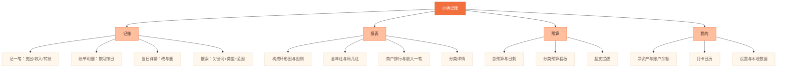

# 需求分析说明书

文档编号：01
产品名称：小满记账（Xiaoman Ledger）
目标平台：iOS（iPhone，390×844 逻辑分辨率）
交付形态：Vite + Vue 3 构建的静态资源，经 Capacitor 6 打包为原生 iOS App
版本：v2.0.0
状态：已冻结（与代码同步，实现偏离必须回写本文档）

## 1. 项目概述

### 1.1 背景

个人记账工具的普遍问题是「打开成本高、记录慢、数据在别人手里」。本项目以一个高保真原型（暖色治愈手账风，画板 S1–S7）为基准，做一款**完全离线**的个人账本：所有数据落在本机，不依赖任何服务端。

### 1.2 目标

| 编号 | 目标 | 可验收口径 |
|------|------|------------|
| G-1 | 记录快 | 从冷启动到可点「记一笔」≤ 1.5 s；一笔支出从打开到落库 ≤ 5 次点击 |
| G-2 | 数据不出机 | 运行时零网络请求：包体内不含 fetch/XMLHttpRequest/WebSocket 调用，不加载任何远程资源 |
| G-3 | 数字可信 | 首页、报表、预算三处的同一口径数字互相对得上，且全部由流水推导，无手写常量 |
| G-4 | 可交付到真机 | `npm run ios:build` 产出 .app 并能在 iOS 17.2 模拟器启动、渲染、写库 |
| G-5 | 视觉还原 | 色彩、字号、圆角、阴影、动效时长与原型 S0 规范板逐值一致 |

### 1.3 范围

#### 1.3.1 范围内

记账（支出/收入/转账）、账单明细、按日详情、搜索、统计报表、分类详情、预算与超支提醒、我的（净资产、账户与资产、打卡日历）、设置（提醒、应用锁、恢复示例账本、清空账目）、示例数据种子与自检。

#### 1.3.2 范围外

多设备同步、云端备份、账单导入导出（CSV/OFX）、OCR 识票、订阅制自动记账、社交与分享榜单、Android 版本、深色模式、iPad 分屏布局、Apple Watch 端。

## 2. 用户与使用场景

### 2.1 目标用户

| 角色 | 特征 | 核心诉求 |
|------|------|----------|
| 主力记账者 | 20–35 岁，单人使用一台 iPhone，月流水 80–200 笔 | 30 秒内记完一天，月度能看清钱去哪了 |
| 隐私敏感用户 | 拒绝把消费明细交给服务端 | 数据只在本机，卸载即消失，无网络请求 |
| 预算执行者 | 给总预算和若干分类设了额度 | 超支要当场发现，并知道连续超了几个月 |

### 2.2 关键场景

| 编号 | 场景 | 触发 | 期望结果 |
|------|------|------|----------|
| SC-1 | 冷启动首看 | 首次安装打开 | 自动灌入与原型同款的示例账本，首页直接呈现本月支出、连续天数、预算进度 |
| SC-2 | 随手记一笔 | 底栏中央按钮 | 数字键盘输入金额 → 选分类 → 保存 → 回到上一页并弹出成功提示，首页与报表数字同步变大 |
| SC-3 | 改一笔 | 明细/当日页点条目 | 弹层展示该笔全部字段，可修改（进入预填表单）或删除 |
| SC-4 | 月度复盘 | 切到报表页 | 环形构成、全年柱、周几均值、商户排行、最大一笔支出，且可点柱切月 |
| SC-5 | 预算调整 | 预算页点「调整总预算」或分类行 | 弹层改额度，当月生效，历史月的超支判定仍按当时额度 |
| SC-6 | 找回示例 | 设置页「恢复示例账本」 | 二次确认后按种子重建，用户自记流水被覆盖 |
| SC-7 | 清空重来 | 设置页「清空账目」 | 二次确认后只删流水，分类/账户/预算模板保留 |

## 3. 功能需求

### 3.1 功能结构

### 3.2 记账（F-1）

| 编号 | 需求 | 验收标准 |
|------|------|----------|
| F-1.1 | 三类流水：支出、收入、转账，同一屏用分段控件切换 | 切换后分类区与账户区按类型正确显示；切类型清空已选分类 |
| F-1.2 | 金额用自定义数字键盘输入，单位为元，最多 9 位数字、1 个小数点、2 位小数 | 输入「23.5」显示 23.5；小数点后第 3 位被截断；超过 9 位数字不再响应 |
| F-1.3 | 金额落库为整数分 | 23.5 元存为 2350，任何求和无浮点误差 |
| F-1.4 | 分类目录：支出 11 类、收入 12 类，格子按目录顺序排布 | 支出页显示 11 格，收入页显示 12 格，两类互不混入 |
| F-1.5 | 账户必选，默认第一个账户；转账需两个不同账户 | 同账户转账保存失败并提示「转入账户要和转出账户不同」 |
| F-1.6 | 发生时间可选今天/昨天/前天或任意日期时间 | 未来时间保存失败并提示「不能记到未来」 |
| F-1.7 | 商户与备注为选填，分别限 24/40 字 | 超长被输入框截断，落库前再次 trim |
| F-1.8 | 保存后写入 IndexedDB 并即时更新内存态 | 首页、明细、报表、预算四处数字同帧更新，无需重进 |
| F-1.9 | 编辑已有流水 | 表单预填原值，保存后 id 不变、updatedAt 变化、列表按新时间重排 |
| F-1.10 | 删除流水 | 库内与内存同时移除，派生数字随之回落 |

### 3.3 明细与搜索（F-2）

| 编号 | 需求 | 验收标准 |
|------|------|----------|
| F-2.1 | 按月切换查看，右箭头在本月及未来月禁用 | 切到 10 月显示 30 天分组、115 笔；本月时下一月按钮 disabled |
| F-2.2 | 天内按时间倒序，天与天倒序 | 每天第一行是当天最晚一笔 |
| F-2.3 | 单日汇总：支出、收入、笔数 | 与逐条相加结果一致 |
| F-2.4 | 搜索命中商户、备注、标签、分类名、账户名（含转入账户） | 关键词「储蓄卡」命中招行支出与转入招行的转账 |
| F-2.5 | 搜索可按类型与时间范围叠加收窄 | 关键词「山姆」+ 本月 与 + 本年 结果不同 |
| F-2.6 | 空关键词不铺全量结果，命中超过 100 条只渲染最近 100 条 | 空输入显示引导文案；输入「奶茶」显示 103 笔命中且仅 100 行 DOM |

### 3.4 报表（F-3）

| 编号 | 需求 | 验收标准 |
|------|------|----------|
| F-3.1 | 分类构成环形图 + 图例，图例最多 8 条，其余并入「其他 N 类」 | 11 个有支出的分类显示为 8 条 + 其他 3 类 |
| F-3.2 | 图例占比一位小数，合计为 0 时全部显示 0% | 清空账本后图例为空且提示「这个月还没有支出」 |
| F-3.3 | 环比上一自然月，上一月为 0 时不给百分比 | 显示「比 2026年10月 多花 4.3%」；上月无账时显示「暂无环比」 |
| F-3.4 | 全年 12 根柱，点柱切换查看月，未来月不可点 | 点 10 月柱后整页切到 10 月，12 月柱点击无效 |
| F-3.5 | 周几均值柱按当年逐日平均，周一起排 | 无支出的周几显示虚线段而非 0 高柱 |
| F-3.6 | 商户排行前 5，按金额倒序 | 与逐条聚合一致 |
| F-3.7 | 分类详情页：当年逐月柱、周几习惯、常去商户、当月流水（最多 20 笔） | 餐饮页显示 42 笔 / ¥1,372.00 / 平均 ¥32.67 |

### 3.5 预算（F-4）

| 编号 | 需求 | 验收标准 |
|------|------|----------|
| F-4.1 | 总预算与分类预算并存，示例值：总 ¥6,000、餐饮 ¥1,500、奶茶 ¥450、交通 ¥800、购物 ¥800、日用品 ¥400、娱乐 ¥300 | 预算页显示 6 项分类预算 + 1 项总预算 |
| F-4.2 | 状态三档：ok（<85%）、near（85%–100%）、over（>100%） | 餐饮 91.5% 为 near，奶茶 114.2% 为 over |
| F-4.3 | 日剩 = 剩余额度 ÷ 本月剩余天数（含今天），向下取整到分 | ¥1,713.50 ÷ 15 = ¥114.23 |
| F-4.4 | 连续超支月数从今天所在月回溯，遇未超或该月无生效额度即停 | 奶茶显示「已连续 3 个月超支」，不是 8 |
| F-4.5 | 改额度写入新版本，effectiveFrom = 当月 | 历史月判定不变，重算后连续月数不异常增长 |
| F-4.6 | 转账不计入任何预算与支出统计 | 记一笔 ¥1,000 转账后，当日支出仍为 ¥73.40 |

### 3.6 我的与设置（F-5）

| 编号 | 需求 | 验收标准 |
|------|------|----------|
| F-5.1 | 净资产 = 各账户（期初 + 全部流水）之和；信用卡余额计负债 | 5 个账户合计 ¥105,033.50，转账前后不变 |
| F-5.2 | 账户余额只推导、不落库 | 库内不存在余额字段，改期初即改推演起点 |
| F-5.3 | 新增/编辑账户：名称、类型、卡号尾号、期初余额 | 新增后出现在列表并按 sortOrder 排布；名称为空时拒绝保存 |
| F-5.4 | 打卡日历：当月每日有无账，连续天数从今天回溯 | 11 月显示 15/15 天，连续 21 天 |
| F-5.5 | 提醒开关与提醒时间（默认 20:00）持久化 | 关闭后时间行消失，重开恢复 |
| F-5.6 | 应用锁开关 + 4 位数字；未设置数字时不允许开启 | 输入「12ab34」清洗为「1234」，开启后重进仍为开 |
| F-5.7 | 恢复示例账本、清空账目均需弹层二次确认 | 确认前不写库；清空后分类/账户/预算保留，流水为 0 |
| F-5.8 | 版本信息来自构建注入 | 设置页显示 2.0.0，与 package.json 一致 |

## 4. 非功能需求

### 4.1 离线与隐私

| 编号 | 约束 | 实现口径 |
|------|------|----------|
| N-1 | 运行时零网络 | 源码内无 fetch/XMLHttpRequest/WebSocket；不引用远程字体、图片、CDN |
| N-2 | 数据只在本机 | 唯一持久层是 IndexedDB（WKWebView 沙盒内），卸载 App 即删除 |
| N-3 | 无第三方跟踪 | 不集成统计、崩溃上报、广告 SDK；Capacitor 插件仅 app/haptics/status-bar |
| N-4 | 应用锁定位 | 4 位数字仅用于本机界面遮罩，明文存于本机 settings 仓库，不做任何上传 |

### 4.2 性能

| 编号 | 指标 | 目标值 | 实测值 |
|------|------|--------|--------|
| P-1 | 冷启动建库 + 灌入 1,281 笔示例 + 首屏 | ≤ 1.5 s | 浏览器实测首屏可见 < 1 s |
| P-2 | 单月明细渲染 | ≤ 200 行 DOM | 11 月 121 行、15 个日分组 |
| P-3 | 记一笔到数字更新 | ≤ 100 ms | 保存后同帧更新，无需回读 |
| P-4 | 搜索命中渲染上限 | 100 行 | 超出仅提示总数 |

### 4.3 可靠性与兼容

| 编号 | 约束 | 口径 |
|------|------|------|
| R-1 | 写库失败不得留下半截状态 | 先写库成功再改内存；失败弹提示且界面数字不变 |
| R-2 | 建库失败进入可恢复错误态 | 显示错误文案与「重新载入」按钮，不白屏 |
| R-3 | 种子自检不通过要可见 | 自检告警非空时以提示条呈现，不静默 |
| R-4 | 兼容范围 | iOS 15.0 及以上；构建与验收在 iOS 17.2 模拟器 |
| R-5 | 跨午夜一致性 | 启动即固定「今天」，同一次运行内所有派生数字用同一锚点 |

## 5. 原型对齐与已知偏差

### 5.1 逐值对齐的原型锚点

| 项目 | 原型值 | 实现值 | 结论 |
|------|--------|--------|------|
| 本月支出 | ¥4,286.50 | ¥4,286.50 | 一致 |
| 本月收入 | ¥12,000.00 | ¥12,000.00 | 一致 |
| 本月结余 | ¥7,713.50 | ¥7,713.50 | 一致 |
| 今天支出/笔数 | ¥73.40 / 4 笔 | ¥73.40 / 4 笔 | 一致 |
| 昨天支出 | ¥373.00 | ¥373.00 | 一致 |
| 连续记账 | 21 天 | 21 天 | 一致 |
| 总预算/已用/日剩 | ¥6,000 / 71.4% / ¥114.23 | ¥6,000 / 71.4% / ¥114.23 | 一致 |
| 奶茶超支 | ¥514 / ¥450，连续 3 个月 | ¥514.00 / ¥450.00，连续 3 个月 | 一致 |
| 分类数 | 支出 11 + 收入 12 | 11 + 12 | 一致 |

### 5.2 有意保留的偏差

| 编号 | 偏差 | 原因 |
|------|------|------|
| D-1 | 账户余额与原型「招行 ¥18,420.66」不同（实现为 ¥69,073.01） | 余额由「期初 + 全部流水」推导，原型数字与流水不自洽 |
| D-2 | 当年流水 1,281 笔，原型标 1,286 笔 | 逐条生成时按分类笔数密度取整，差异 < 0.4% |
| D-3 | 奶茶/餐饮的当年占比与原型文案不同 | 占比是推导结果，原型该处文案与自身流水不自洽 |
| D-4 | 原型把 2026-11-14 标为「周五」，实现按真实日历显示周六 | 日历推导，不复制原型的排版错误 |
| D-5 | 原型报表页的「全年支出 ¥65,746.50 / 环比 −397.45% / 平均每天 ¥2,193.55」等数字不还原 | 这些值与原型自身月度合计矛盾，实现一律以流水推导为准 |

## 6. 验收清单

| 编号 | 验收项 | 方式 |
|------|--------|------|
| A-1 | 5.1 全部锚点在真机/模拟器首页可见 | 截图 + DOM 文本比对 |
| A-2 | 记一笔、改一笔、删一笔后四处数字自洽 | 交互回归 |
| A-3 | 清空账目后各页空态不崩、恢复示例后锚点复现 | 交互回归 |
| A-4 | 运行时网络请求数为 0 | 抓包/网络面板核对 |
| A-5 | iOS 模拟器安装并启动成功 | xcodebuild + simctl 输出 |
| A-6 | 单测覆盖工具层、领域层、仓储层、种子层与状态层 | vitest 全绿 |
