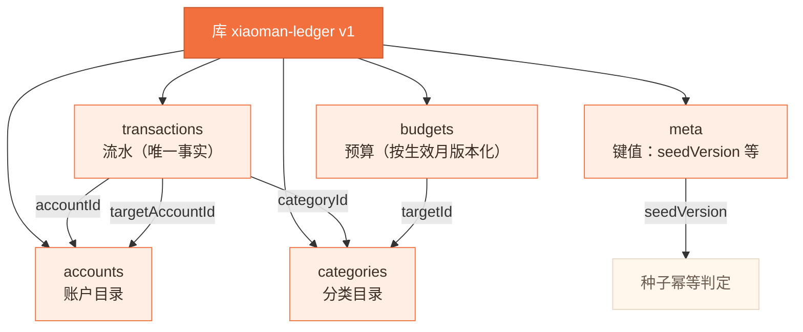
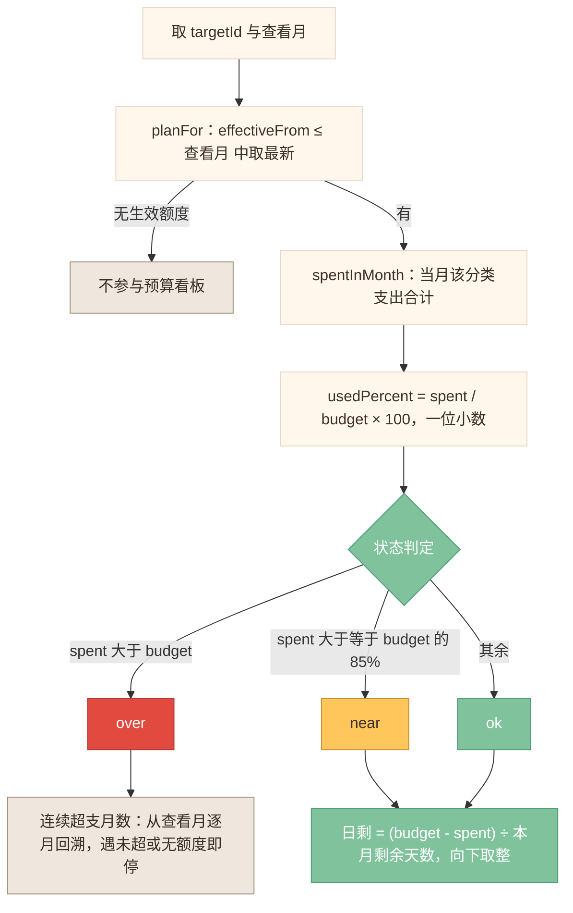

# 数据库设计说明书

文档编号：04
存储引擎：IndexedDB（W3C IDBKeyRange 语义，经 idb@8 封装）
库名：xiaoman-ledger
库版本：1
宿主：iOS WKWebView（Capacitor 6），浏览器预览同源
状态：已冻结（与代码同步，实现偏离必须回写本文档）

## 1. 设计原则

| 编号 | 原则 | 落地方式 |
|------|------|----------|
| DB-P-1 | 单一事实源 | 只有 IndexedDB 是持久事实；内存态是它的副本，余额/统计一律推导，不落库 |
| DB-P-2 | 金额无浮点 | 所有金额字段名以 `Cents` 结尾，类型为整数分，展示层才除 100 |
| DB-P-3 | 时间可比较 | 所有时间为本地墙钟串 `YYYY-MM-DDTHH:mm:ss`，字典序等于时间序，因此 key range 直接可用 |
| DB-P-4 | 左闭右开 | 区间查询用 `[lower, upper)`，跨月跨年靠 upper 自动翻位，不写「23:59:59」这类边界补丁 |
| DB-P-5 | 写路径原子 | 一次写入只开一个事务，涉及的全部 store 在 `WRITE_STORES` 内声明 |
| DB-P-6 | 无外键约束 | IndexedDB 不提供级联，引用完整性由上层校验（如分类删除前检查流水引用） |
| DB-P-7 | 可重放 | 种子数据由确定性算法生成，同一 `today` 输入必得同一数据集，便于「恢复示例账本」 |

## 2. 存储全景



## 3. 对象仓库明细

### 3.1 transactions（流水）

| 字段 | 类型 | 必填 | 说明 |
|------|------|------|------|
| id | string | 是 | 主键。种子数据 `seed:<日期段>:<序号>`，用户数据 `user:<36 进制时间><随机>` |
| kind | `'expense' \| 'income' \| 'transfer'` | 是 | 方向由 kind 决定，金额恒为正 |
| amountCents | number（整数分） | 是 | > 0；上限 9,999,999,999 分 |
| categoryId | string \| null | 条件 | expense/income 必填；transfer 恒为 null |
| accountId | string | 是 | 支出来账账户；transfer 为转出账户 |
| targetAccountId | string | 条件 | 仅 transfer 存在，转入账户 |
| occurredAt | string | 是 | 墙钟串 `YYYY-MM-DDTHH:mm:ss`，索引字段 |
| merchant | string | 是 | 可为空串，落库前 trim |
| note | string | 是 | 可为空串，落库前 trim |
| tags | string[] | 是 | 可为空数组，落库时复制一份 |
| createdAt | number | 是 | 毫秒时间戳，仅用于审计 |
| updatedAt | number | 是 | 毫秒时间戳，编辑时刷新 |

索引：`occurredAt`、`categoryId`、`accountId`、`kind`。

### 3.2 categories（分类目录）

| 字段 | 类型 | 必填 | 说明 |
|------|------|------|------|
| id | string | 是 | 主键，内置 id 语义化（food、milkTea、salary…） |
| kind | `'expense' \| 'income'` | 是 | 决定出现在哪个选择器 |
| name | string | 是 | 中文显示名，与原型逐条一致 |
| icon | string | 是 | 图标 id（与 `CATEGORY_ICONS` 的中文键做二次映射） |
| tileColor | string | 是 | 色块底色，取自原型 S0 马卡龙色板 |
| glyphColor | string | 是 | 图标主色，同时用于图表配色 |
| sortOrder | number | 是 | 目录内排序，从 1 开始 |
| builtin | boolean | 是 | 内置分类不可删除 |

规模：支出 11 条 + 收入 12 条 = 23 条。

### 3.3 accounts（账户目录）

| 字段 | 类型 | 必填 | 说明 |
|------|------|------|------|
| id | string | 是 | 主键 |
| name | string | 是 | 显示名 |
| kind | `'cash' \| 'debit' \| 'ewallet' \| 'credit'` | 是 | credit 参与负债口径 |
| tail | string | 否 | 卡号尾号，仅展示 |
| openingBalanceCents | number（整数分） | 是 | 期初余额，余额推演的唯一起点 |
| color | string | 是 | 账户主色 |
| sortOrder | number | 是 | 列表排序 |
| builtin | boolean | 是 | 内置账户不可删除 |

规模：内置 5 条（微信零钱、招商银行 储蓄卡、零钱通、支付宝、现金）。

### 3.4 budgets（预算）

| 字段 | 类型 | 必填 | 说明 |
|------|------|------|------|
| id | string | 是 | 主键，`<targetId>#<effectiveFrom>`，同月改额度即覆盖该版本 |
| targetId | string | 是 | `'total'` 表示月度总预算，否则为支出分类 id |
| amountCents | number（整数分） | 是 | > 0 |
| effectiveFrom | string `YYYY-MM` | 是 | 含本月的生效起点 |
| updatedAt | number | 是 | 毫秒时间戳 |

索引：`targetId`。示例种子 7 条：total 600,000、food 150,000、milkTea 45,000、transport 80,000、shopping 80,000、daily 40,000、entertain 30,000。

### 3.5 meta（键值）

| 字段 | 类型 | 说明 |
|------|------|------|
| id | string | 主键，即键名 |
| value | any | 目前仅 `seedVersion`（number）被使用 |

### 3.6 settings（应用设置，存于 meta 的单条记录）

`getSettings()` 从 meta 仓库的 `id = 'app'` 记录读写，字段如下：

| 字段 | 类型 | 默认值 | 说明 |
|------|------|--------|------|
| id | `'app'` | `'app'` | 固定单例主键 |
| currencySymbol | string | `'¥'` | 展示符号 |
| weekStartsOnMonday | true | true | 类型层面锁死，日历与周几柱均以周一起排 |
| reminderEnabled | boolean | true | 每日提醒开关 |
| reminderTime | string | `'20:00'` | `HH:mm` |
| theme | `'cream'` | `'cream'` | 只有暖纸一套主题 |
| appLockEnabled | boolean | false | 应用锁开关 |
| unlockPin | string | `''` | 4 位数字，关闭时清空 |
| monthlyResetDay | number | 1 | 月度周期起点，当前所有口径按自然月 1 日 |
| seedVersion | number | 0 | 与 `SEED_VERSION` 比较决定是否需要灌种子 |
| onboardedAt | string \| null | null | 首次完成引导的墙钟串 |

## 4. 键区间规则

### 4.1 统一构造

```ts
rangeOf(from, to) => IDBKeyRange.bound(from, to, false, true)   // 左闭右开
monthRange('2026-11') => ['2026-11-01T00:00:00', '2027-01-01T00:00:00')
dayRange('2026-11-15') => ['2026-11-15T00:00:00', '2026-11-16T00:00:00')
```

### 4.2 边界约定

| 场景 | 规则 | 反例（禁止） |
|------|------|--------------|
| 取整月 | 用 `monthRange` 的上界为下月 1 日 00:00 | 用 `'2026-11-30T23:59:59'` 会漏掉 30 日之后的亚秒数据 |
| 取整天 | 上界为次日 00:00 | 用 `'23:59:59'` 同上 |
| 月末翻年 | 由 `addMonths` 进位到 1 月 | 手写 `'2026-12-31T23:59:59'` |
| 派生日/月 | `slice(0,10)` / `slice(0,7)` | 用 `new Date()` 解析后再比较（时区风险） |

## 5. 枚举字典

| 枚举 | 取值 | 语义 |
|------|------|------|
| Transaction.kind | expense / income / transfer | 支出计预算、收入不计支出、转账两者都不计 |
| Category.kind | expense / income | 决定选择器与统计口径 |
| Account.kind | cash / debit / ewallet / credit | credit 的负余额计入负债 |
| BudgetStatus.state | ok / near / over | 阈值：spent > budget 为 over；spent ≥ budget×0.85 为 near；其余 ok |
| BudgetStatus.targetId | total / 分类 id | total 走「整月支出」口径 |
| Settings.theme | cream | 唯一主题 |
| LoadPhase | idle / loading / ready / error | 决定外壳显示骨架、内容还是错误态 |
| SeedOutcome.action | seeded / kept | 本次启动是否灌了种子 |

## 6. 派生数据规则

### 6.1 账户余额

```
balance(account) = openingBalanceCents
                 + Σ(income.amountCents where accountId == account.id)
                 - Σ(expense.amountCents where accountId == account.id)
                 - Σ(transfer.amountCents where accountId == account.id)
                 + Σ(transfer.amountCents where targetAccountId == account.id)
```

净资产 = 非 credit 账户余额之和；credit 账户余额取负后计入负债。

### 6.2 预算判定



### 6.3 连续记账与账龄

| 指标 | 规则 |
|------|------|
| streakDays | 从今天往回逐日检查是否有流水；今天没记不算断，从昨天起算 |
| ledgerAge | `diffDays(最早一笔的日期, 今天) + 1`，无流水为 0 |
| 打卡日历 | 查看月每一天标记 `recorded / future`，未来日不可点 |

### 6.4 种子数据

| 项 | 值 |
|----|----|
| 随机源 | FNV-1a 哈希 `xiaoman:<monthKey>` → mulberry32，逐月独立 |
| 覆盖范围 | 从今天往前 12 个自然月（含当月至今） |
| 当月口径 | 分类金额逐分对齐原型 S2a 拆分表，笔数抄原型 |
| 历史月口径 | 按占比向量分摊月目标；奶茶/医疗/学习/其他按锚点覆盖 |
| 自检 | `verifySeed` 校验月合计、余额非负、目录齐备、锚点数字，告警写入 `warnings` |
| 幂等 | `meta.seedVersion == SEED_VERSION && 流水数 > 0` 时不重灌 |

## 7. 容量与性能

| 项 | 估算 | 依据 |
|----|------|------|
| 单条流水序列化 | 约 220 B | 12 字段，字符串为主 |
| 示例账本 | 1,281 条 ≈ 280 KB | 实测当年流水数 |
| 十年个人用量 | 约 2 万条 ≈ 4.4 MB | 按每月 165 笔 |
| 全量载入 | 1,281 条 < 100 ms | 单次 `getAll` + 内存排序 |
| 冷启动灌入 | < 1 s | 单事务批量 put |
| 存储上限 | 远小于 WKWebView 配额（GB 级） | 不触发配额告警 |

## 8. 版本与迁移

| 项 | 规则 |
|----|------|
| DB_VERSION | 当前 1；新增 store 或索引必须 +1 并在 `upgrade` 内按 `oldVersion` 分支补建 |
| 破坏性变更 | 禁止在 `upgrade` 内删除既有仓库或改写历史数据 |
| 字段扩展 | 新字段必须可缺省读取，读取处给默认值，不做历史回填 |
| 种子版本 | `SEED_VERSION` 变更会触发一次重灌，重灌前 `clearAll()`，用户自记流水被覆盖，因此仅在示例数据结构变化时递增 |
| 回滚 | 卸载 App 即清空；不提供库内回滚脚本 |
