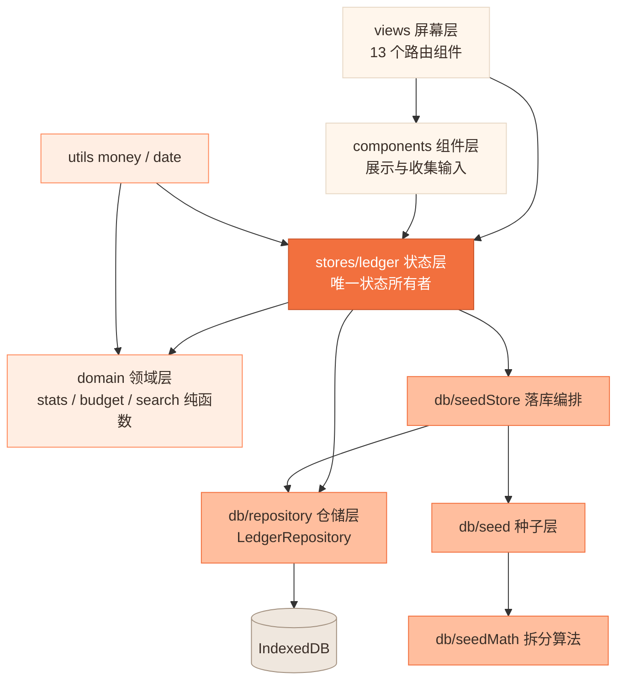

# 接口设计文档

文档编号：05
接口类型：进程内模块接口（本产品无 HTTP/RPC 接口，全离线）
调用方向：视图 → 状态层 → 领域层 / 仓储层 → IndexedDB
状态：已冻结（与代码同步，实现偏离必须回写本文档）

## 1. 分层与调用约束

| 编号 | 约束 | 违反后果 |
|------|------|----------|
| API-C-1 | 屏幕不得直接 import 仓储层或 idb | 出现两处状态源，写库与内存不一致 |
| API-C-2 | 领域层必须是纯函数，不触碰 IndexedDB、DOM、Pinia | 无法单测，数字口径随调用点漂移 |
| API-C-3 | 组件不得写库，只发事件或由屏幕调用状态层 | 绕过校验，产生非法流水 |
| API-C-4 | 金额跨层传递一律整数分，只在展示层转元 | 浮点误差累积 |
| API-C-5 | 时间跨层传递一律墙钟串，不传 `Date` 对象 | 时区/夏令时导致区间漏算 |

## 2. 仓储层接口

### 2.1 连接与键区间

| 接口 | 签名 | 语义 |
|------|------|------|
| openLedgerDb | `(): Promise<IDBPDatabase>` | 打开/升级库，每次调用返回新连接 |
| getLedgerRepository | `(): Promise<LedgerRepository>` | 进程内单例，屏幕与状态层共用一条连接 |
| rangeOf | `(from: string, to: string) => IDBKeyRange` | 左闭右开 |
| monthRange | `(monthKey: string) => IDBKeyRange` | `YYYY-MM` → 该月首日到下月首日 |
| dayRange | `(dayKey: string) => IDBKeyRange` | `YYYY-MM-DD` → 当日到次日 |

### 2.2 LedgerRepository 方法

| 方法 | 签名 | 返回/失败 |
|------|------|-----------|
| listCategories | `(kind?: CategoryKind) => Promise<Category[]>` | 按 sortOrder 升序；不传 kind 返回全部 |
| getCategory | `(id: string) => Promise<Category \| undefined>` | 不存在返回 undefined |
| putCategory | `(category: Category) => Promise<void>` | 同 id 覆盖 |
| deleteCategory | `(id: string) => Promise<void>` | 不校验引用，引用检查在状态层 |
| listAccounts | `() => Promise<Account[]>` | 按 sortOrder 升序 |
| getAccount | `(id: string) => Promise<Account \| undefined>` | 同上 |
| putAccount | `(account: Account) => Promise<void>` | 同 id 覆盖 |
| listAllTransactions | `() => Promise<Transaction[]>` | 按 occurredAt 升序 |
| listTransactions | `(from: string, to: string) => Promise<Transaction[]>` | 左闭右开区间 |
| listTransactionsOfMonth | `(monthKey: string) => Promise<Transaction[]>` | 整月 |
| getTransaction | `(id: string) => Promise<Transaction \| undefined>` | 同上 |
| putTransaction | `(tx: Transaction) => Promise<void>` | 单条写入 |
| bulkPutTransactions | `(list: Transaction[]) => Promise<void>` | 一个事务内批量 put，幂等 |
| deleteTransaction | `(id: string) => Promise<void>` | 不存在时静默成功 |
| countTransactions | `() => Promise<number>` | 全量计数 |
| firstOccurredAt | `() => Promise<string \| null>` | 空库返回 null |
| listBudgetPlans | `() => Promise<BudgetPlan[]>` | 全部版本 |
| putBudgetPlan | `(plan: BudgetPlan) => Promise<void>` | 同 id 覆盖 |
| bulkPutBudgetPlans | `(list: BudgetPlan[]) => Promise<void>` | 批量 |
| deleteBudgetPlan | `(id: string) => Promise<void>` | 静默 |
| getSettings | `() => Promise<Settings>` | 缺记录时返回 DEFAULT_SETTINGS |
| saveSettings | `(settings: Settings) => Promise<void>` | 整条覆盖 |
| getMeta | `<T>(key: string) => Promise<T \| undefined>` | 键值读 |
| setMeta | `<T>(key: string, value: T) => Promise<void>` | 键值写 |
| clearTransactions | `() => Promise<void>` | 只清流水 |
| clearAll | `() => Promise<void>` | 五个仓库全清 |

失败约定：IndexedDB 原生错误（配额、版本冲突、事务中断）直接向上抛出，由状态层或屏幕转成用户可见提示，仓储层不吞异常。

## 3. 领域层接口

### 3.1 stats（统计口径）

| 函数 | 签名 | 口径 |
|------|------|------|
| isExpense / isIncome | `(t: Transaction) => boolean` | kind 判定 |
| sumCents | `(rows: Transaction[], kind?: Kind) => number` | 传 kind 只累加该类 |
| expenseCents / incomeCents | `(rows: Transaction[]) => number` | 转账不计 |
| groupByDay | `(rows: Transaction[]) => DayGroup[]` | 天倒序，天内倒序 |
| categoryBreakdown | `(rows, categories, kind) => { totalCents, slices[] }` | 金额倒序，占比一位小数 |
| merchantRank | `(rows, limit = 5) => { name, amountCents, count }[]` | 空商户归「未命名」 |
| monthlyBars | `(rows, monthKeys, labelOf?) => BarPoint[]` | 缺月补 0 |
| recentMonthKeys | `(today: Date, n: number) => string[]` | 旧月在前 |
| yearMonthKeys | `(year: number) => string[]` | 当年 1–12 月 |
| weekdayBars | `(rows, anchorDay) => BarPoint[]` | 锚点所在周，周一起 |
| weekdayAverages | `(rows) => { weekday, avgCents, totalCents, count }[]` | 逐日汇总后按周几取平均 |
| streakDays | `(rows, todayDayKey) => number` | 今天没记从昨天起算 |
| ledgerAgeDays | `(rows, todayDayKey) => number` | 首笔到今天 +1 |
| accountBalanceCents | `(account, rows) => number` | 见 04 文档 6.1 |
| accountBalances | `(accounts, rows) => { account, balanceCents }[]` | 目录顺序 |
| netWorth | `(accounts, rows) => NetWorth` | credit 计负债 |
| periodComparison | `(current, previous) => { expenseChangePercent, incomeChangePercent }` | 上期为 0 返回 null |
| dailyAllowanceCents | `(remainingCents, monthKey, todayDayKey) => number` | 剩余天数含今天，向下取整 |
| maxExpense | `(rows) => Transaction \| undefined` | 最大一笔支出 |

### 3.2 budget（预算口径）

| 函数 | 签名 | 口径 |
|------|------|------|
| TOTAL_BUDGET_TARGET | `'total'` | 总预算 targetId 常量 |
| planFor | `(plans, targetId, monthKey) => BudgetPlan \| null` | effectiveFrom ≤ 查看月 中取最新 |
| spentInMonth | `(rows, monthKey, categoryId \| null) => number` | null 为整月支出口径 |
| consecutiveOverMonths | `(plans, rows, targetId, monthKey) => number` | 逐月回溯，最多 120 层保护 |
| budgetStatus | `(targetId, name, icon, tileColor, plans, rows, monthKey, todayDayKey) => BudgetStatus \| null` | 无生效额度返回 null |
| budgetBoard | `(plans, categories, rows, monthKey, todayDayKey) => BudgetBoard` | items 按 usedPercent 倒序，未设预算的分类不出现 |
| overBudgetList | `(board) => BudgetStatus[]` | state 为 over，按 overCents 倒序 |

`BudgetStatus` 字段：`targetId, name, icon, tileColor, budgetCents, spentCents, remainingCents, usedPercent, overCents, perDayRemainingCents, consecutiveOverMonths, state`。

### 3.3 search（搜索口径）

| 函数 | 签名 | 口径 |
|------|------|------|
| matchesQuery | `(row, text, names) => boolean` | 商户/备注/标签/分类名/账户名包含匹配，大小写不敏感，空串放行 |
| inScope | `(row, query, today) => boolean` | all / month / year，按墙钟串前缀比较 |
| searchRows | `(rows, query, today, names) => Transaction[]` | 类型 + 范围 + 关键词三条件叠加，时间倒序 |

`SearchQuery` 字段：`text: string`、`kind: 'all' | 'expense' | 'income' | 'transfer'`、`scope: 'all' | 'month' | 'year'`。

## 4. 状态层接口（Pinia store `ledger`）

### 4.1 状态

| 字段 | 类型 | 初值 | 说明 |
|------|------|------|------|
| phase | LoadPhase | `'idle'` | 外壳据此显示骨架/内容/错误 |
| errorMessage | string | `''` | 建库失败文案 |
| seedWarnings | string[] | `[]` | 种子自检告警 |
| today | DayKey | 启动日 | 固定锚点，跨午夜不漂移 |
| currentMonth / viewMonth / year / monthLabel | 派生 | — | viewMonth 只影响视图 |
| transactions / categories / accounts / budgetPlans | 数组 | `[]` | 库内全量副本 |
| settings | Settings | DEFAULT_SETTINGS | 单例 |

### 4.2 动作

| 动作 | 签名 | 返回语义 |
|------|------|----------|
| load | `(overrides?: { now?: Date; repo?: LedgerRepository }) => Promise<void>` | 建库 → 必要时灌种子 → 全量载入；失败置 error 态 |
| addEntry | `(draft: EntryDraft) => Promise<string \| null>` | 成功 null；失败返回可直接展示的文案 |
| updateEntry | `(id: string, patch: Partial<EntryDraft>) => Promise<string \| null>` | 记录不存在返回「这条记录已被删除」 |
| removeEntry | `(id: string) => Promise<void>` | 删除后内存同步 |
| setBudget | `(targetId: string, amountCents: number) => Promise<string \| null>` | 非正整数返回「预算要大于 0」 |
| saveCategory / saveAccount / saveSettings | `(x) => Promise<void>` | 写库后重读目录 |
| removeCategory | `(id: string) => Promise<string \| null>` | 被引用时返回「这个分类下还有 N 笔记录，先改分类再删」 |
| rebuildDemo | `() => Promise<void>` | 覆盖式重建示例 |
| wipeLedger | `() => Promise<void>` | 只清流水 |
| shiftViewMonth | `(delta: number) => void` | 未来月被忽略 |

### 4.3 校验错误文案（完整枚举）

| 文案 | 触发条件 |
|------|----------|
| 金额要大于 0 | amountCents 非整数或 ≤ 0 |
| 选一个分类再记 | 非转账且 categoryId 为空 |
| 选一个账户再记 | accountId 为空 |
| 转入账户要和转出账户不同 | 转账缺转入账户或与之相同 |
| 不能记到未来 | occurredAt 大于今天 23:59:59 |
| 这条记录已被删除 | 编辑目标不在内存中 |
| 预算要大于 0 | 预算额度非正整数 |
| 这个分类下还有 N 笔记录，先改分类再删 | 删除被引用的分类 |

## 5. 种子层接口

| 接口 | 签名 | 说明 |
|------|------|------|
| SEED_VERSION | number = 3 | 与 meta.seedVersion 比较 |
| buildSeedDataset | `(options: { today?: Date }) => SeedDataset` | 纯生成，不碰库 |
| applySeed | `(repo, dataset) => Promise<void>` | clearAll 后按目录 → 预算 → 流水 → 设置 → meta 顺序写入 |
| ensureSeeded | `(repo, options?) => Promise<SeedOutcome>` | 已灌且版本一致返回 kept |
| restoreDemoData | `(repo, options?) => Promise<SeedDataset>` | 覆盖式重建 |
| clearUserData | `(repo) => Promise<void>` | 只清流水并回写 seedVersion |
| computeInvariants / validateInvariants | 见 `db/seedVerify.ts` | 输出锚点数字与告警列表 |

`SeedDataset` 字段：`transactions, categories, accounts, budgetPlans, settings, warnings`。

## 6. 屏幕与路由契约

### 6.1 路由表

| 路径 | name | depth | tab | 屏幕 |
|------|------|-------|-----|------|
| `/` | — | — | — | 重定向到 `/home` |
| `/home` | home | 0 | home | S1 首页 |
| `/ledger` | ledger | 1 | home | S2 账单明细 |
| `/ledger/day/:dayKey` | day | 2 | home | 当日详情（props: dayKey） |
| `/search` | search | 1 | home | 搜索 |
| `/reports` | reports | 0 | reports | S3 统计报表 |
| `/reports/:categoryId` | category-report | 1 | reports | 分类详情（props: categoryId） |
| `/budget` | budget | 0 | budget | S4 预算 |
| `/budget/alerts` | budget-alerts | 1 | budget | 超支提醒 |
| `/profile` | profile | 0 | profile | S6 我的 |
| `/profile/calendar` | calendar | 1 | profile | 打卡日历 |
| `/profile/accounts` | accounts | 1 | profile | S7 账户与资产 |
| `/profile/settings` | settings | 1 | profile | S7 设置 |
| `/entry/:kind(expense\|income\|transfer)` | entry | 1 | — | S5 记一笔（props: kind，query.id 为编辑目标） |
| `/:pathMatch(.*)*` | — | — | — | 重定向到 `/home` |

### 6.2 转场契约

| 条件 | 动画 |
|------|------|
| 层级相同（含切 tab） | fade 0.18 s |
| 同 tab 且层级加深 | fwd 0.26 s（横向 26 px） |
| 同 tab 且层级回退 | back 0.26 s |
| 跨 tab | fade |
| 记一笔页 | 隐藏底栏，`route.meta.tab === undefined` |

### 6.3 组件接口

| 组件 | props | emits |
|------|-------|-------|
| NavBar | title, subtitle?, rightIcon?, rightText?, back?=true | right |
| TabBar | — | — |
| EntryRow | row: Transaction, compact? | click |
| MoneyText | cents: number, display?=true, decimals?=2 | — |
| Icon | name?: IconName, category?: string, size?=24, color? | — |
| Sheet | open: boolean, title?, grabber?=true | close |
| MonthSwitch | — | — |
| Keypad | — | key(string), back, clear, date, submit |
| CategoryGrid | categories, modelValue, kind | update:modelValue |
| DonutChart | slices{key,amountCents,color}[], centerLabel, centerValue, size?=132, thickness?=22 | — |
| BarChart | points{key,label,cents}[], highlightKey?, dense?=false, maxBarHeight?=72 | select(key) |
| BudgetTotalCard | status: BudgetStatus | edit(status) |

### 6.4 提示（Toast）接口

| 接口 | 签名 | 说明 |
|------|------|------|
| show | `(title: string, desc?: string, duration?: number, action?: { label, run }) => void` | 默认 2200 ms，新提示替换旧提示 |
| dismiss | `() => void` | 立即收起并清理定时器 |

## 7. 工具层接口

### 7.1 money

| 函数 | 签名 | 说明 |
|------|------|------|
| yuanToCents / centsToYuan | 互转 | 乘除 100，前者四舍五入取整 |
| formatCents | `(cents, { grouping?, decimals?, signed? }?) => string` | 4,286.50 形式 |
| formatTransactionAmount | `(cents, kind) => string` | 支出 −、收入 +、转账无符号 |
| formatMoney | `(cents, options?) => string` | 带 ¥，负号用 − |
| splitMoney | `(cents, options?) => { symbol, body }` | Hero 拆列 |
| percentOf | `(part, whole, decimals = 0) => number` | 分母 ≤ 0 返回 0 |
| keypadTextToCents | `(text: string) => number` | 上限 9,999,999,999 分 |
| formatKeypadDisplay | `(text: string) => string` | 千分位实时显示 |
| keypadAppend / keypadBackspace | `(current, key?) => string` | 9 位数字 + 单小数点约束 |

### 7.2 date

| 函数 | 签名 | 说明 |
|------|------|------|
| nowWallClock | `(at?: Date) => string` | 本地墙钟串 |
| dayKeyOf / dayKeyOfDate / monthKeyOf | 取前缀 | 不构造 Date |
| addDays / addMonths | 进位安全 | 月末翻月正确 |
| daysInMonth / monthDayKeys | 月内日期序列 | — |
| weekRange / previousWeekRange | 周一起 | — |
| weekdayCn / weekdayShort / cnMonthDay / shortMonthDay / cnYearMonth / cnYear | 展示格式化 | — |
| relativeDayLabel | `(key, today?) => string \| null` | 今天/昨天/前天 |
| diffDays / remainingDaysInMonth / elapsedDaysInMonth | 天数计算 | 未来月剩余 0 |
| timeOfDay | `(occurredAt) => string` | `HH:mm` |

## 8. 变更流程

| 步骤 | 要求 |
|------|------|
| 1 | 先改本文档对应表格，标注接口签名、返回语义、错误文案 |
| 2 | 同步修改实现与调用点，全仓检索该符号确认无遗漏 |
| 3 | 补齐或更新单测，覆盖新增分支与错误路径 |
| 4 | 若涉及库结构，同步 04 文档并递增 DB_VERSION |
| 5 | 若涉及锚点数字，同步 01 文档 5.1 表格 |
